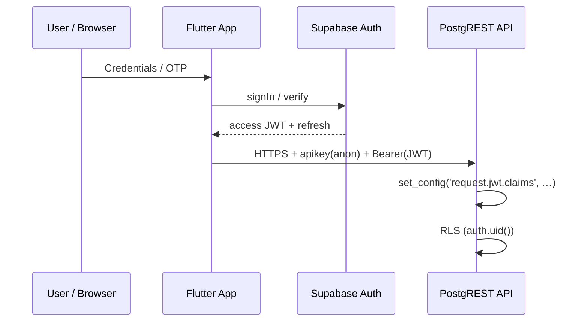

# Authentication flow (high level)

## Notes

- **Never** ship `service_role` in `A`.  
- Web: consider idle timeout (`web_session_ttl` pattern).
- Quick PIN unlock is available only for an existing Supabase session on a device
  registered to that account. The server verifies the device before completing
  the session gate; a PIN or local preference never replaces credentials or OTP
  for a new login. Browser PIN unlock requires the trusted-device migration.
- An inactivity lock keeps the existing session and routes to the PIN screen when
  quick unlock is enabled. Explicit sign-out, revoked sessions, and expired
  sessions still require the regular authentication flow.
- Enabling, changing, or disabling a quick PIN requires a short-lived,
  action- and trusted-device-bound OTP challenge. The PIN verifier stays in the
  device's secure storage; development OTP plaintext is never added to
  notification rows and is cleared after use or expiry.

## Evidence

- `docs/regulatory_evidence/JWT_VALIDATION_EVIDENCE.md`  
- `supabase/sql/staging_validation/validate_jwt_claims.sql`
